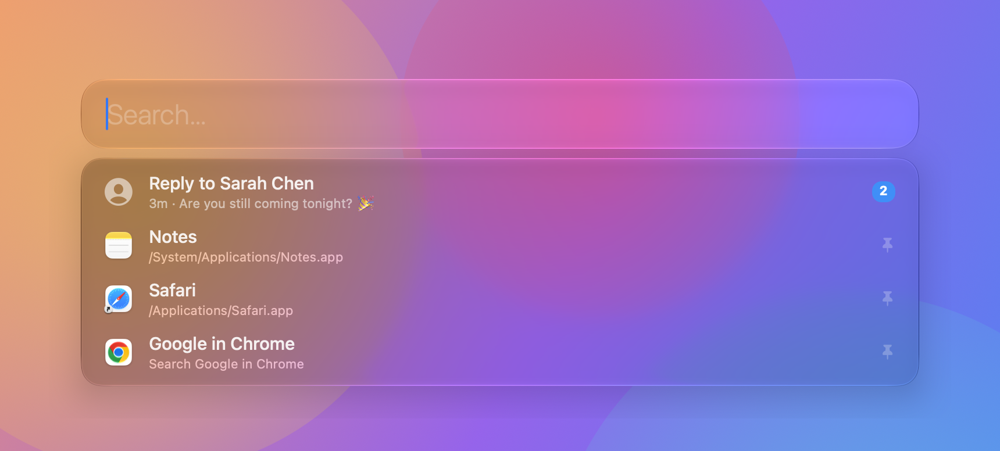
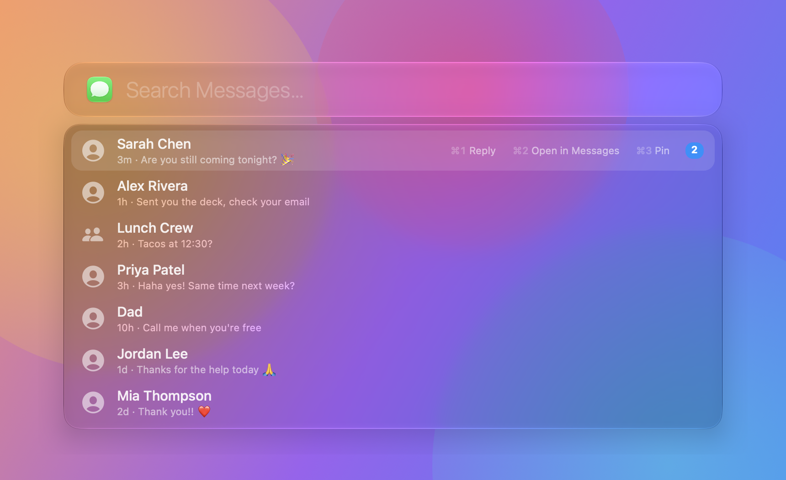
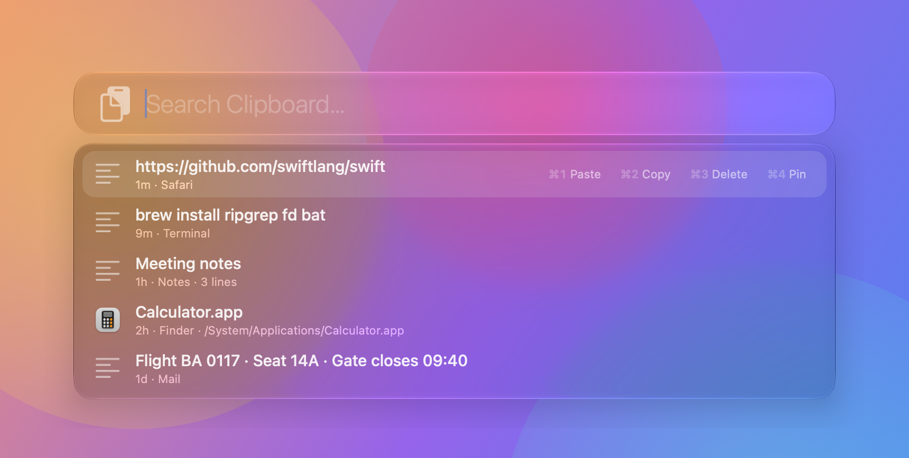
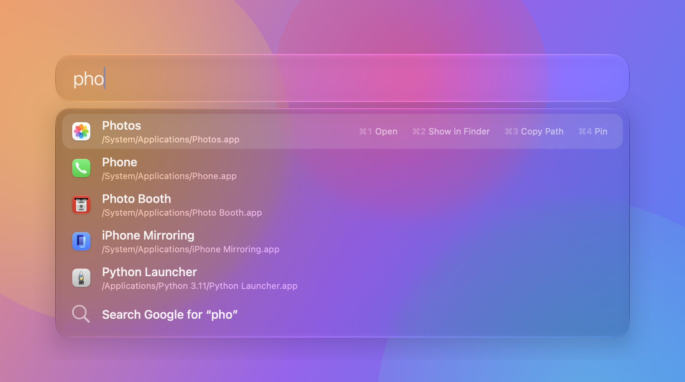
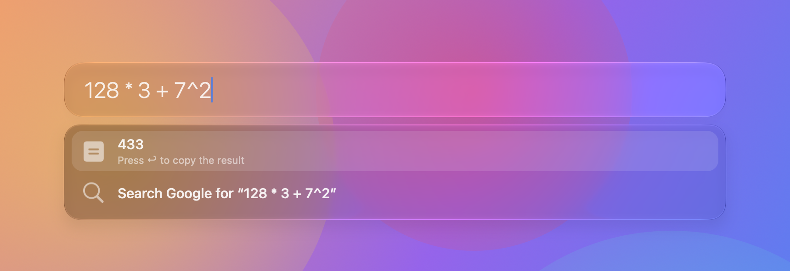
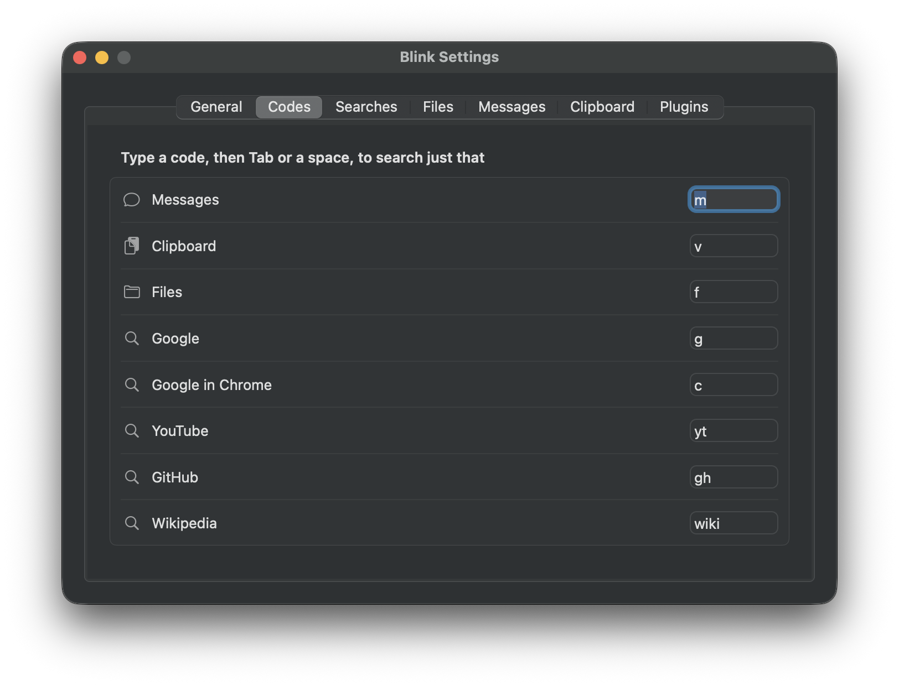

<p align="center">
  
</p>

<h1 align="center">Blink</h1>

<p align="center">
  <b>A fast, native macOS launcher that also lets you read and reply to iMessages without leaving the keyboard.</b><br>
  Apps · files · calculator · web search · clipboard history · Messages · plugins
</p>

<p align="center">
  <a href="https://github.com/jo-sip/blink/actions/workflows/ci.yml"></a>
  
  
  <a href="LICENSE"></a>
</p>

<p align="center">
  
</p>

Press <kbd>⌘</kbd> <kbd>Space</kbd>, and Blink is already showing the message you just got. Press <kbd>↩</kbd>, type
your reply, press <kbd>↩</kbd> again, and you're back to work. It also does everything you'd expect from a launcher,
in a ~3 MB native app with no account, no subscription and no network calls of its own.

## Features

|  |  |
| --- | --- |
| **💬 Messages, built in** | Unread conversations are pinned at the top for 15 minutes. Reply inline with the last few messages shown, and watch it go *Sending… → Delivered → Read*. Search people by name, nickname or relationship ("brother"). Spam from unknown senders is hidden. |
| **⚡ Instant search** | Fuzzy app search in well under a millisecond, learning what you open most. Folders like Downloads and Desktop, Spotlight-backed file search, URLs and a calculator. |
| **📋 Clipboard history** | <kbd>⌥</kbd><kbd>⌘</kbd><kbd>C</kbd> for everything you've copied: text, files and images. Pastes straight into the app you were in. Passwords are never recorded. |
| **⌨️ Codes** | Type <kbd>m</kbd> <kbd>Tab</kbd> to search Messages, <kbd>v</kbd> for clipboard, <kbd>f</kbd> for files, <kbd>c</kbd> to Google in Chrome. Add your own web searches. |
| **📌 Pins** | <kbd>⌘</kbd><kbd>P</kbd> pins anything (apps, folders, conversations, clipboard snippets) to the top of the launcher. |
| **🎛️ Actions on every row** | <kbd>→</kbd> or <kbd>Tab</kbd> steps through each row's actions (Open, Show in Finder, Copy Path, Contact Card, …), or hit <kbd>⌘</kbd><kbd>1</kbd>–<kbd>9</kbd>. |
| **🧩 Plugins** | Any script that prints JSON becomes a search. Speaks **Alfred's Script Filter format**, and imports `.alfredworkflow` files. |
| **🫧 Liquid Glass** | Native AppKit with Apple's Liquid Glass on macOS 26+, a frosted fallback on older versions. Light and dark. |

## Screenshots

<table>
  <tr>
    <td></td>
    <td></td>
  </tr>
  <tr>
    <td align="center"><sub><kbd>m</kbd> <kbd>Tab</kbd>: conversations, latest first</sub></td>
    <td align="center"><sub>Reply inline, see when it's delivered</sub></td>
  </tr>
  <tr>
    <td></td>
    <td></td>
  </tr>
  <tr>
    <td align="center"><sub><kbd>⌥</kbd><kbd>⌘</kbd><kbd>C</kbd>: clipboard history</sub></td>
    <td align="center"><sub>Fuzzy app search with row actions</sub></td>
  </tr>
  <tr>
    <td></td>
    <td></td>
  </tr>
  <tr>
    <td align="center"><sub>Calculator, ↩ copies the answer</sub></td>
    <td align="center"><sub>Settings: hotkeys, codes, searches and more</sub></td>
  </tr>
</table>

<sub>All screenshots use made-up demo data. Regenerate them with `scripts/screenshots.sh`.</sub>

## Install

Blink isn't on the App Store, so you build it yourself. It takes about a minute.

```bash
git clone https://github.com/jo-sip/blink.git
cd blink
scripts/build-app.sh --install
```

This needs **macOS 13 or later** and Xcode or its command-line tools (`xcode-select --install`). Xcode 26 or later
gives you the Liquid Glass look; older versions build with the frosted style. The app is copied to `/Applications`
and starts at login (turn that off in Settings → General).

**⌘Space is Spotlight's by default.** To give it to Blink, open System Settings → Keyboard → Keyboard Shortcuts →
Spotlight and untick *Show Spotlight search*. Or choose another hotkey in Blink's Settings. Until you do, the ⚡ menu
bar icon shows a warning triangle.

### Permissions

macOS asks for each one the first time a feature needs it. Everything else works without them.

| Permission | Used for |
| --- | --- |
| Full Disk Access | Reading your Messages conversations (`~/Library/Messages/chat.db`), read-only |
| Contacts | Showing names and photos instead of phone numbers |
| Automation → Messages | Sending your replies through the Messages app |
| Accessibility | Pasting clipboard history straight into the app you're in |

## Using Blink

| Keys | Does |
| --- | --- |
| <kbd>↑</kbd> <kbd>↓</kbd> or the mouse | Move between results |
| <kbd>↩</kbd> | Open, reply, copy or paste: whatever the row does |
| <kbd>⌘</kbd><kbd>↩</kbd> | The row's alternate action (e.g. Show in Finder, open in Messages) |
| <kbd>→</kbd> / <kbd>←</kbd>, <kbd>Tab</kbd> | Step through the highlighted row's actions |
| <kbd>⌘</kbd><kbd>1</kbd>…<kbd>9</kbd> | Run a row action directly |
| <kbd>⌘</kbd><kbd>P</kbd> | Pin or unpin the row |
| <kbd>⌘</kbd><kbd>,</kbd> | Settings |
| <kbd>Esc</kbd> | Back out of a reply or scope, then close |

| Type | Gets you |
| --- | --- |
| `saf` | Apps, folders and people, ranked by what you use |
| `12*(3+4)` | A calculator; ↩ copies the result |
| `github.com/you` | Opens the URL |
| `m` <kbd>Tab</kbd>, then a name | Your conversations; ↩ to reply |
| `v` <kbd>Tab</kbd> | Clipboard history |
| `f` <kbd>Tab</kbd> `invoice` | Files, via Spotlight's index |
| `g cats`, `c cats`, `yt`, `gh`, `wiki` | Web searches (`c` opens in Chrome) |

All codes are editable in Settings → Codes.

## Plugins

Drop an executable into `~/.config/blink/plugins/`. Its file name becomes its code, so `emoji.sh` answers
`emoji fire`. Blink passes the query as `$1` and shows whatever JSON the script prints:

```json
{"items": [
  {"title": "🔥 fire", "subtitle": "Copy to clipboard", "copy": "🔥"},
  {"title": "Open the docs", "open": "https://example.com", "actions": [{"title": "Copy link", "copy": "https://example.com"}]}
]}
```

Each item can `open` a URL or path, `copy` text or `run` a shell command, and add extra `actions`. Scripts can
also print **Alfred's Script Filter JSON** (`arg`, `valid`, `autocomplete`, `mods`, `icon`), and Settings →
Plugins → *Import Alfred Workflow…* turns `.alfredworkflow` Script Filters into Blink codes. See
[`examples/emoji.sh`](examples/emoji.sh).

## FAQ

<details open>
<summary><b>Why would I use this over Spotlight or Alfred?</b></summary>

**Messages.** Neither Spotlight nor Alfred can show you who has messaged you, or let you read and answer a conversation
from the launcher. With Blink, a new message is the first thing you see when you open it, and replying takes two
keystrokes. You see the last few messages and whether your reply was delivered, and you never switch apps or lose your
place.

**Over Spotlight,** Blink is built for speed rather than searching everything. Results appear as you type, without
the list jumping around, and the apps you use most rise to the top. You also get things Spotlight doesn't do: clipboard
history, pins, codes that jump straight into a search, an action menu on every row, and plugins.

**Over Alfred,** you get the features Alfred charges for in its Powerpack (clipboard history, workflows, custom web
searches, contacts), free and open source, plus the Messages integration Alfred doesn't have. You don't have to give up
your workflows either: Blink reads Alfred's Script Filter format and can import `.alfredworkflow` files.

**And** it's small, native and private. A few MB of Swift, no Electron, no account, no telemetry, nothing sent
anywhere.
</details>

<details>
<summary><b>Is my data private?</b></summary>

Yes. Blink makes no network requests of its own. It reads your Messages database read-only and sends replies through
the Messages app. Everything it stores stays on your Mac in plain files:

- `~/.config/blink/`: settings and plugins
- `~/Library/Application Support/Blink/`: pins, usage counts, clipboard history
- `~/Library/Logs/Blink.log`: what Blink did (never what you type or message content)

Clipboard history skips anything apps mark as private (passwords, one-time codes) and everything copied in password
managers. You can clear it at any time.
</details>

<details>
<summary><b>Does it work with WhatsApp, Signal or Slack?</b></summary>

Not yet. Apple's Messages keeps its conversations in a database on your Mac, which is what makes the integration
possible. Other apps don't expose theirs. A plugin could add one where the app has an API.
</details>

<details>
<summary><b>Can I see typing indicators or send tapbacks?</b></summary>

No. macOS doesn't let other apps see the "typing…" dots or send reactions. Blink shows everything Messages does
store: your message, its status (Sent, Delivered, Read with time, or Not delivered) and new replies as they arrive.
</details>

<details>
<summary><b>⌘Space doesn't open Blink.</b></summary>

Spotlight is probably still using it (the menu bar icon shows a warning triangle). See [Install](#install). The log
(⚡ menu → Open Log) records every hotkey press, which helps tell whether macOS is passing the key to Blink.
</details>

<details>
<summary><b>Why isn't there a download?</b></summary>

Apps downloaded from the internet need to be signed and notarised with a paid Apple Developer ID, or macOS blocks
them. Building from source avoids that, because the app was made on your own Mac. The release script is ready for when
a signed build exists (`scripts/build-app.sh --release`).
</details>

## Development

```bash
swift test              # 60 unit tests, a few seconds, no permissions needed
scripts/smoke.sh        # runs the real app: search results, speed, one redraw per keystroke
scripts/screenshots.sh  # regenerates docs/screenshots from demo data
swift scripts/make-icon.swift   # redraws the app icon
```

Tests use made-up contacts and a generated fake Messages database, and run in throwaway folders, so they never touch
your settings or messages. Architecture notes and the contribution checklist are in [CONTRIBUTING.md](CONTRIBUTING.md).

## License

[MIT](LICENSE)
